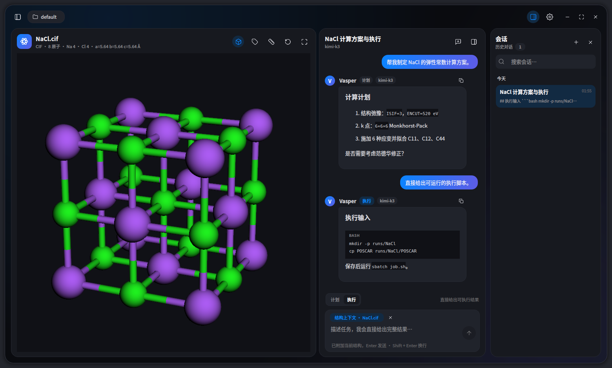
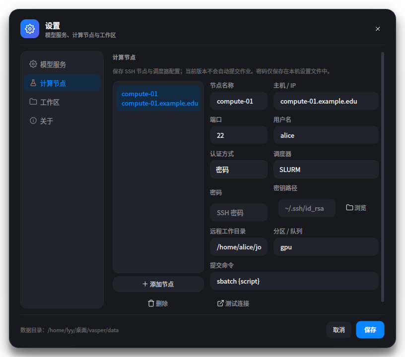

<div align="center">

# Vasper

**自然语言驱动的 VASP / 材料结构桌面工作台**

把 3D 晶体结构、周期边界、文件管理、LLM 对话和计算节点配置，收进一个原生桌面应用。

[](https://www.python.org/)
[](https://www.riverbankcomputing.com/software/pyqt/)
[](https://3dmol.csb.pitt.edu/)
[](LICENSE)
[](#)

[快速开始](#快速开始) · [界面](#界面) · [周期边界](#周期边界显示) · [技术架构](#技术架构) · [许可证](#license)

</div>

<p align="center">
  
</p>

<p align="center">
  <sub>3D 球棍结构 · 周期镜像原子 · 计划/执行对话 · 会话管理</sub>
</p>

---

## 目录

- [为什么是 Vasper](#为什么是-vasper)
- [界面](#界面)
- [功能](#功能)
- [快速开始](#快速开始)
- [配置](#配置)
- [周期边界显示](#周期边界显示)
- [使用与快捷键](#使用与快捷键)
- [支持的结构格式](#支持的结构格式)
- [技术架构](#技术架构)
- [性能与兼容性](#性能与兼容性)
- [数据与安全](#数据与安全)
- [已知限制 / Roadmap](#已知限制--roadmap)
- [贡献](#贡献)
- [License](#license)
- [致谢](#致谢)

---

## 为什么是 Vasper

材料计算工作流通常散落在多个工具里：结构文件在文件夹中，3D 可视化在独立软件里，计算方案和输入文件靠对话与笔记整理，远端节点又需要单独的 SSH 配置。

Vasper 把这些环节放进一个本地窗口：

- **不用浏览器、不启动 Web 服务**：完整界面是 PyQt6 原生窗口，3D 部分通过内嵌 QtWebEngine + 本地 3Dmol 渲染。
- **结构、对话、节点配置在同一屏**：左侧文件树、中间 3D 结构、右侧 LLM 对话与历史会话。
- **面向真实材料结构**：球棍模型、晶胞、周期镜像原子、跨边界完整键，而不是“看起来像分子”的展示。
- **本地优先**：文件、会话、截图和配置都留在本机；API Key / 节点密码不会上传到第三方（除模型请求本身外）。

---

## 界面

### 主工作台

<p align="center">
  
</p>

- 无边框、透明阴影、22px 圆角的深色窗口。
- 左侧文件树默认收起，点击顶栏左侧按钮或 `Ctrl+B` 展开。
- 3D 视图默认球棍模型，NaCl 等结构会显示边界镜像原子。
- 右侧可以切换 **计划 / 执行** 模式，并与历史会话并行查看。

### 分页设置

<p align="center">
  
</p>

设置分为 **模型服务 / 计算节点 / 工作区 / 关于** 四页，计算节点页支持多节点、SSH 参数和 TCP 连接测试。

---

## 功能

### 3D 结构视图
- 固定球棍模型，CIF / POSCAR 自动按共价半径补键。
- 晶胞线框、元素标签、元素图例。
- 原子点击信息：元素、序号、笛卡尔坐标；选中原子以橙黄色网格球高亮（略大于实体球）。
- 两点测距：依次点击两个原子，显示精确 Å 距离；**镜像原子同样可选中和测距**。
- 拖动旋转、滚轮缩放、右键平移；重置视角、专注模式。
- 周期边界：边界附近生成镜像原子并绘制完整键，详见 [周期边界显示](#周期边界显示)。

### 文件管理器
- 可折叠面板，目录懒加载、递归搜索。
- 点击结构文件直接在 3D 视图打开，并自动附加为对话上下文。
- 新建文件夹、重命名、删除、在系统文件管理器中显示。
- 直接拖拽文件到目录树即可上传；文本文件支持只读预览。
- 支持切换工作区根目录。

### LLM 对话
- OpenAI 兼容接口，流式回复，可随时停止。
- 停止生成时保留已生成内容并持久化。
- **计划模式**：拆解目标、给出参数与执行步骤，不直接产出最终结果。
- **执行模式**：直接给出完整脚本、命令、输入文件内容与保存路径。
- Markdown 渲染：标题、列表、表格、代码块、引用、链接与强调。
- 当前结构自动作为上下文发送给模型（会截断过长文件）。

### 会话管理
- 可折叠会话抽屉，按“今天 / 昨天 / 更早”分组。
- 自动用首条用户消息生成标题。
- 支持搜索、重命名、删除、切换会话；重启后恢复最近会话。
- 每条助手消息标记当时使用的模式（计划 / 执行）。

### 设置
- **模型服务**：Base URL、API Key、模型、温度；可导入同机 sci-circle 的 `[llm_api]` 配置。
- **计算节点**：多节点 SSH 配置（主机、端口、用户名、密码 / 私钥、远程目录、调度器、分区、提交命令），支持 TCP 端口测试。
- **工作区**：切换结构文件根目录。
- **关于**：版本、技术栈、数据目录与安全说明。

### 桌面体验
- 无边框圆角窗口 + 柔和阴影，自绘最小化 / 最大化 / 关闭按钮。
- 顶栏可拖动，双击最大化；窗口边缘可拖拽缩放。
- 最大化时自动取消圆角与阴影，还原后恢复。
- 深色主题统一：窗体外框、3D 画布、消息气泡与弹窗。

---

## 快速开始

### 环境要求

- Linux（已在 Wayland / XWayland 环境验证）
- Python 3.11
- 能运行 QtWebEngine（OpenGL / SwiftShader 均可）

### 使用 conda（推荐）

```bash
git clone https://github.com/moyulyy/vasper.git
cd vasper

# 项目内环境，避免依赖系统 Python
conda env create -p .conda/envs/vasper -f environment.yml

./run.sh
```

`run.sh` 会优先使用 `.conda/envs/vasper/bin/python`；也可以指定其他解释器：

```bash
VASPER_PYTHON=/path/to/python ./run.sh
```

### 使用已有 Python 环境

```bash
python -m pip install -r requirements.txt
python main.py
```

---

## 配置

### 模型服务

首次启动后点击右上角 **设置 → 模型服务**：

| 字段 | 说明 |
| --- | --- |
| API Base URL | 任意 OpenAI 兼容地址；留空则使用官方地址 |
| API Key | 仅保存在本机 `data/settings.json` |
| 模型名称 | 例如 `kimi-k3`、`gpt-4o`、`deepseek-chat` |
| 温度 | 0.0 – 2.0 |

也支持环境变量作为初始配置：

```bash
export OPENAI_API_KEY="sk-..."
export OPENAI_BASE_URL="https://api.example.com/v1"
export OPENAI_MODEL="model-name"
```

没有 API Key 时，对话会返回本地配置引导，不会静默失败。

### 计算节点

**设置 → 计算节点** 可保存多个 SSH 节点：

- 名称、主机/IP、端口、用户名
- 密码或 SSH 私钥路径
- 远程工作目录
- 调度器：SLURM / PBS / LSF / 本地
- 分区/队列、提交命令（例如 `sbatch {script}`）
- “测试连接”仅检查 TCP 端口是否可达，不会执行登录

> 当前版本**不会自动登录节点或提交作业**；节点配置用于后续计算工作流。密码以明文保存在本机 `data/settings.json`。

### 工作区

默认工作区为 `workspaces/default/`，示例结构位于 `workspaces/default/examples/`。

运行时数据保存在 `data/`：

- `data/settings.json`：模型与节点配置
- `data/sessions/`：会话 JSON
- `data/screenshots/`：预留截图目录

---

## 周期边界显示

Vasper 的 3D 视图针对晶体结构做了 Materials Studio 风格的周期显示：

1. **边界镜像**：分数坐标距 `0` 或 `1` 不超过 `0.02` 的原子，沿每个贴近边界的轴生成所有组合镜像，保证晶胞的面、棱、角处都有原子。
2. **跨边界成键**：对仍然跨边界的原子对，搜索相邻 27 个周期镜像；若某个镜像落在成键阈值内，则在晶胞外补对应镜像原子。
3. **完整键**：对扩展后的原子集合重新按共价半径成键，边界处不会出现悬空半键。
4. **性能上限**：基胞原子超过 240 个时回退为普通成键；镜像总数上限 700，避免大结构拖慢交互。

示例：NaCl 岩盐结构默认会显示约 19 个镜像原子，晶胞的每一条棱都连续可见；镜像原子参与拾取与测距。跨边界补原子只向正方向扩展，避免负轴远处出现多余镜像。

---

## 使用与快捷键

| 快捷键 | 功能 |
| --- | --- |
| `Ctrl + B` | 显示 / 收起文件管理器 |
| `Ctrl + Shift + B` | 显示 / 收起会话管理 |
| `Ctrl + N` | 新建对话 |
| `Ctrl + ,` | 打开设置 |
| `Enter` | 发送消息 |
| `Shift + Enter` | 换行 |
| `Esc` | 退出专注模式 / 收起会话抽屉 |

3D 视图：

| 操作 | 效果 |
| --- | --- |
| 左键拖动 | 旋转 |
| 滚轮 | 缩放 |
| 右键拖动 | 平移 |
| 单击原子 | 显示元素、序号、坐标 |
| 测距模式 + 两个原子 | 显示距离 |
| 重置按钮 | 恢复初始视角 |

---

## 支持的结构格式

| 格式 | 说明 |
| --- | --- |
| `.cif` / `.mcif` | 晶胞、元素、原子数 |
| `.xyz` / `.extxyz` | 自动成键 |
| `.pdb` / `.ent` | 蛋白质 / 分子结构 |
| `.mol` / `.mol2` / `.sdf` / `.sd` | 分子结构 |
| `POSCAR*` / `CONTCAR*` / `.vasp` | 自动解析晶格与坐标并转换为 CIF 渲染 |

示例结构：`NaCl.cif`、`Si.cif`、`water.xyz`、`POSCAR-Si`。

---

## 技术架构

```text
┌──────────────────────────── PyQt6 主窗口 ────────────────────────────┐
│  FilePanel        ViewerPanel              ChatPanel      SessionPanel │
│  文件树            QWebEngineView           流式对话       会话历史     │
│                   ↕ QWebChannel                                      │
│                   viewer.html + viewer.js + 3Dmol (WebGL)             │
│                                                                       │
│  SettingsDialog（模型服务 / 计算节点 / 工作区 / 关于）                  │
└───────────────────────────────────────────────────────────────────────┘
```

- **没有 Flask / HTTP 服务**：文件操作、结构解析、会话、LLM 请求均由 Python 进程内完成。
- **3D 桥接**：JS 通过 QWebChannel 回传 ready / state / pick / error；Python 下发结构、晶胞、标签、测距等指令。
- **模型接口**：OpenAI Python SDK 的流式接口，兼容 Moonshot、DeepSeek、OpenAI、本地 vLLM 等。
- **设置**：`app/config.py` 负责本地 JSON 读写；设置分页 UI 只操作本地数据。

### 目录结构

```text
vasper/
├── main.py                  # 启动入口
├── run.sh                   # 启动脚本
├── environment.yml          # conda 环境
├── requirements.txt
├── app/
│   ├── config.py            # 设置、工作区、LLM / 节点配置
│   ├── files.py             # 工作区文件操作
│   ├── structures.py        # 结构解析 / POSCAR→CIF
│   ├── sessions.py          # 会话持久化
│   ├── llm.py               # 流式 LLM 与计划/执行提示
│   ├── workers.py           # QThread 流式任务
│   ├── markdown_render.py   # Markdown → QTextBrowser HTML
│   ├── theme.py             # iOS 风格深色主题 / QSS
│   ├── icons.py             # 内置 SVG 图标
│   └── widgets/
│       ├── main_window.py   # 无边框主窗口、三栏布局
│       ├── viewer_panel.py  # 3D 视图与 QWebChannel
│       ├── chat_panel.py    # 对话、模式、气泡
│       ├── session_panel.py # 会话管理
│       ├── file_panel.py    # 文件树与预览
│       ├── settings_dialog.py
│       ├── sheets.py        # 统一弹窗
│       └── components.py
├── assets/
│   ├── viewer.html / viewer.js
│   ├── 3Dmol-min.js
│   └── screenshot-*.png
└── workspaces/default/examples/
```

---

## 性能与兼容性

- 当前环境无独显 / WebGL 被 Chromium 拉黑时，默认提供：
  ```text
  --enable-unsafe-swiftshader --ignore-gpu-blocklist --disable-gpu-compositing
  ```
  既保证 3D 可见，也避免部分 Wayland 环境出现白屏。
- 3D 浮层已移除 `backdrop-filter` 实时模糊，关闭 3Dmol 抗锯齿，降低软件渲染负担。
- 周期镜像扩展对大结构设有上限，避免构建过多原子与键。
- 若你的环境有可用 GPU，可通过 `QTWEBENGINE_CHROMIUM_FLAGS` 自行调整渲染参数。

---

## 数据与安全

- 文件操作限制在当前工作区内（阻止 `..` 和绝对路径逃逸）。
- 所有运行时数据位于 `data/`，已加入 `.gitignore`。
- **API Key 与计算节点密码以明文保存在本机 `data/settings.json`**；请勿提交该文件或分享给他人。
- 计划 / 执行模式只改变模型输出策略，**不会自动运行命令或修改文件**。
- 计算节点“测试连接”只做 TCP 可达性检查，不进行 SSH 登录或执行。

---

## 已知限制 / Roadmap

- [x] 3D 结构球棍显示与周期镜像
- [x] LLM 计划 / 执行双模式
- [x] 多节点 SSH 配置与端口测试
- [x] 无边框圆角桌面窗口
- [ ] 根据自然语言生成 VASP 输入文件
- [ ] 可视化编辑结构（增删原子 / 替换元素）
- [ ] 通过 SSH 提交作业并回传状态
- [ ] 晶格参数、键角、配位数统计面板
- [ ] 更多结构格式与导出

---

## 贡献

欢迎提交 Issue 或 Pull Request：

```bash
git checkout -b feature/your-feature
# 修改代码
git commit -m "feat: your feature"
git push origin feature/your-feature
```

提交前请至少运行：

```bash
python -m py_compile main.py app/*.py app/widgets/*.py
```

---

## License

本项目使用 [MIT License](LICENSE)。

---

## 致谢

- [3Dmol.js](https://3dmol.csb.pitt.edu/)：WebGL 分子 / 晶体结构渲染。
- Qt for Python（PyQt6）与 QtWebEngine。
- 结构预览与周期显示思路参考了同机 `sci-circle` 项目的 CIF 查看器实现。
- 感谢 VASP 与材料计算社区提供的工具与文档。

---

<p align="center">
  <sub>Vasper · 用自然语言连接结构、计算与对话</sub>
</p>
